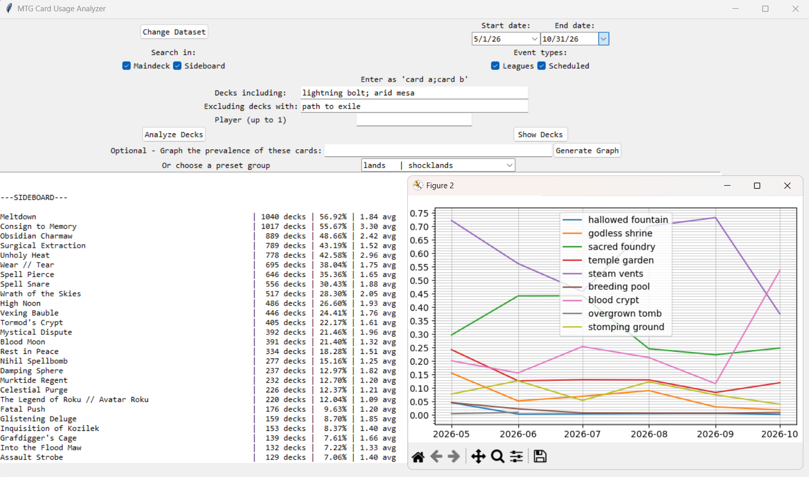
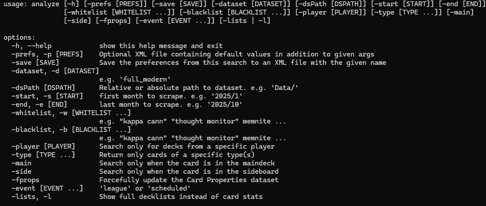
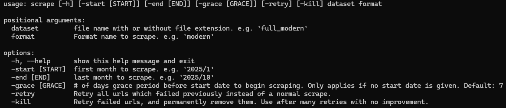

# Magic: The Gathering Online Card Choice Analyzer
This is a GUI / CLI application and web scraper that uses data published by MTGO.com to help tune competitive MTG decks and learn from historical deck trends.

## Key features

### Deck analysis
Drill deep into decks based on criteria such as included/excluded cards, date, format, player, event, sideboard cards, and more. View the most relevant decklists or study greater metagame trends. Discover breakout sideboard cards before they catch on for a big advantage. Bypass weak traditional archetype tags to identify specific, comprehensive insights into individual deck variants.

### Metagame trends
Generate charts showing how card choices have changed over time. Examine how a deck has evolved through metagame shifts, or use preset deck and card category groups (e.g. artifact decks, artifact hate cards, most popular decks, etc.) to stay a step ahead of the metagame.

Powered by a custom C++ SAX parser for immediate analysis across more than a decade of tournament data: [C++ SAX Parser & Benchmarks](src/cpp/README.md)

### Scraper and datasets
Get started right away using the [provided format datasets](data/) containing all MTGO records to date.

Run the lightweight scraper yourself for daily updates. A multi-level retry system tracks which tournaments have already been analyzed, ones that must be retried due to website downtime, and ones that are dead. Taking mere seconds per format, the scraper can be run as an automated daily task (Task Scheduler / cron job) with no disruption.

## Setup

### Prerequisites
- Python 3.13+
- A C++20 compatible compiler and CMake

### Installation
```bash
# Clone the repo
git clone https://github.com/nkogut/MTGCardUsageAnalyzer.git
cd MTGCardUsageAnalyzer

# Create and activate a virtual environment
python -m venv venv
venv\Scripts\activate    # Windows only
source venv/bin/activate # Mac/Linux only

# Install Python dependencies and build the C++ SAX parser
pip install .
```
## Usage


### GUI

```python -m mtgo_decklist_analyzer.gui```



### Command Line Interface

The Scraper and Card Analyzer functionality is available via the command line. To learn more, try out the commands below:

#### Card Analyzer

Find detailed stats about decks right in the command line. \
Quickly adjust a wide variety of criteria to refine your searches.

```python -m mtgo_decklist_analyzer.analyze -h```



#### Scraper

Scrape months worth of decks at a time using the scraper CLI. \
Easily maintain separate databases for different formats and timeframes.

```python -m mtgo_decklist_analyzer.scrape -h```



